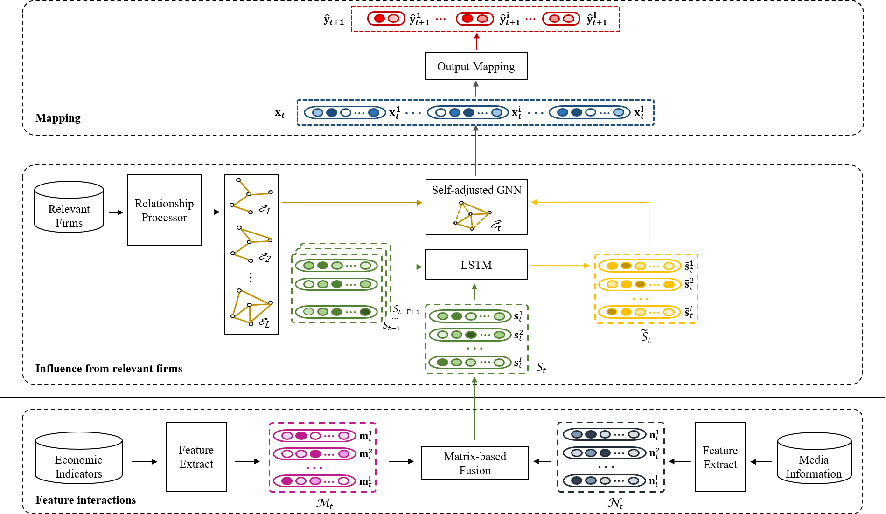

# Asset Pricing via Deep Graph Learning to Incorporate Heterogeneous Predictors

**Authors:** Jiwen Huang, Rong Xing, Qing Li  
**Journal:** *International Journal of Intelligent Systems*, 2022, 37, 8462–8489  
**DOI:** https://doi.org/10.1002/int.22950

## Model Architecture



## Overview

### Source Code

- `layers.py` contains two modules of the SA-GNN model: Matrix-based Feature Fusion (`MatrixFusionLayer`) and Self-adaptive GNN (`ExplicitLayer`).
- `models.py` contains the SA-GNN model.
- `utils.py` contains data loading (`load_data`) and evaluation metrics (`metrics`).
- `train_evaluation.py` integrates the above components and executes the complete model training and evaluation process on our datasets.

### Raw Data & Data Preprocessing
The raw datasets and corresponding preprocessing code are available for download from [Google Drive](https://drive.google.com/drive/folders/1ss1bycGQ4l98YkvvOknSF6Bv_PM1MhS7?usp=sharing).

```text
raw_data
├── raw_data_SP500
│   ├── DataProcessing
│   │   ├── Economic_Indicators_Data_Processing.ipynb
│   │   ├── Firm_Relations_Processing.ipynb
│   │   └── Textual_Media_Processing.ipynb
│   ├── EconomicData
│   ├── NewsData
│   └── RelationData
└── raw_data_SSE50
    ├── DataProcessing
    │   ├── Economic_Indicators_Data_Processing.ipynb
    │   ├── Firm_Relations_Processing.ipynb
    │   └── Textual_Media_Processing.ipynb
    ├── EconomicData
    ├── NewsData
    └── RelationData
```

**Note:** Due to copyright restrictions on news content, only a subset of the news text data is provided.

## Code Submission & Maintenance

**GitHub:** [JiwenHuangFIC](https://github.com/JiwenHuangFIC)