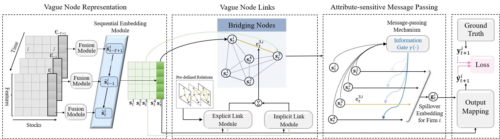

# Learning to Understand the Vague Graph for Stock Prediction With Momentum Spillovers

**Authors:** Rong Xing, Rui Cheng, Jiwen Huang, Qing Li, Jingmei Zhao  
**Journal:** *IEEE Transactions on Knowledge and Data Engineering*, 2024, 36(4), 1698–1712  
**DOI:** https://doi.org/10.1109/TKDE.2023.3310592

## Model Architecture



## Overview

- `layers.py` contains three modules of the VGNN model:
  - Vague Node Representation (`TensorFusionLayer`, `MatrixFusionLayer`);
  - Vague Node Links (`ImplicitLayer`, `ExplicitLayer`);
  - Attribute-sensitive Message Passing (`AttributeGate`).
- `models.py` contains the VGNN model.
- `utils.py` contains data loading (`load_data`) and evaluation metrics (`R2_score_calculate`, `IC_ICIR_score_calculate`).
- `train_evaluation.py` integrates the above components and executes the complete model training and evaluation process on our dataset.
- `BackTesting.ipynb` contains the investment simulation experiments.
- `Simulation.ipynb` contains a simple experiment using simulated data to illustrate the effectiveness of the proposed tensor-based fusion method in capturing dynamic feature interactions.

## Environment

- Python==3.8.5
- PyTorch==1.6.0
- NumPy==1.19.2
- Pandas==1.1.3

## Run

```bash
python train_evaluation.py
```

## Data

### Transactional Data

Due to storage limitations, only a small subset of the data is provided in this repository (`./data`), as the complete raw dataset is approximately 3.8 GB.

The complete raw dataset is available from [Dacheng Xiu's Homepage](https://dachxiu.chicagobooth.edu) [1].

### Company Relations

Firm relationship data are available in `./data/relations`, including industry classifications and headquarters locations.

**Reference**

[1] S. Gu, B. Kelly, and D. Xiu, "Empirical Asset Pricing via Machine Learning," *The Review of Financial Studies*, vol. 33, no. 5, pp. 2223–2273, 2020.

## Code Submission & Maintenance

**GitHub:** [jiwenhuangfic](https://github.com/jiwenhuangfic)