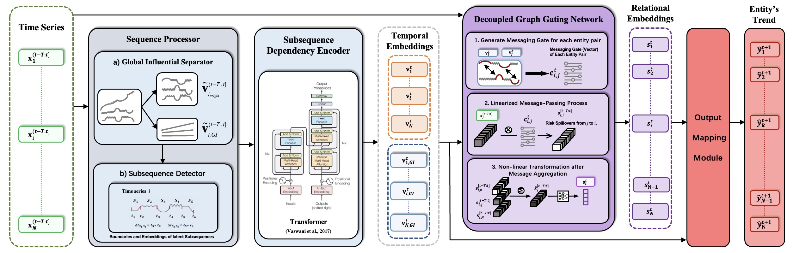

# Lead–LagNet: Exploiting Lead–Lag Dependencies for Cross-Series Temporal Prediction

**Authors:** Zhilong Xie, Shaofei Shen, Jiwen Huang, Rui Cheng, Qing Li  
**Venue:** Proceedings of the 34th ACM International Conference on Information and Knowledge Management (CIKM '25), 2025  
**Paper:** https://doi.org/10.1145/3746252.3761153  
**Code owner:** Zhilong Xie ([@xzl1008](https://github.com/xzl1008))

## Overview

Lead–LagNet predicts the next-period trend of each entity in a multi-variate time
series by exploiting lead–lag dependencies across series. The implementation in
this folder is the code used for the CIKM 2025 paper.



### Code map

| File | Content |
| --- | --- |
| `main.py` | Training / validation / test entry point (command-line interface). |
| `Models.py` | `DRSN`, the complete Lead–LagNet model (sequence processor + graph gating + output mapping). |
| `SequencialLayers.py` | Subsequence detector, Global Influential Separator (GIS), and the subsequence-based temporal encoder. |
| `RelationalModule.py` | Decoupled Graph Gating Network: momentum-spillover gate, linearized message passing, non-linear transformation. |
| `RotaryTransformer.py` | Rotary positional-encoding Transformer blocks used by the temporal encoder. |
| `evaluator.py` | Ranking / portfolio metrics: MSE, MRR, IC, AAR, EAAR, AV, EAV, MDD, EMDD. |
| `loss_fun.py` | Loss functions (MSE / rank loss). |
| `utils.py` | Seeding, logging, masking and adjacency helpers. |
| `Reproduction.ipynb` | Reproduction of the stock-prediction experiments reported in the paper (uses the released checkpoints). |
| `figures/framework.png` | Model framework figure. |

## Environment

The code was developed and tested with:

- Python 3.8.5
- PyTorch 2.2.2, CUDA 12.2, NVIDIA driver 535.129
- One NVIDIA A100 GPU (the model runs in `torch.float64`, so GPU memory is the main constraint)

Install the dependencies from this folder:

```bash
pip install -r requirements.txt
# CUDA 12.x build of the pinned PyTorch version (optional, if the default wheel is CPU-only)
pip install torch==2.2.2 --index-url https://download.pytorch.org/whl/cu121
```

`requirements.txt` intentionally pins only the versions reported in the paper;
the remaining packages have no documented pinned version.

## Data

### Dataset description

- **Name:** S&P 500 daily market dataset, three market regimes (bull / bear / sideways).
- **Source:** author-constructed dataset built from S&P 500 market data.
- **Version:** the released release corresponding to the CIKM 2025 paper.
- **Download link:** <https://drive.google.com/file/d/11diAIO8g1KYJScD3sAaAVAg6U6WL2lY1/view?usp=sharing>
- **Access code:** not required
- **Access conditions:** none
- **Mirror:** if the Google Drive link is not reachable, contact the code owner for a Baidu Netdisk mirror.

Each regime has its own files:

| Regime | Period used in the paper | Stocks | Data file | Relation file |
| --- | --- | --- | --- | --- |
| Bull | 01/08/2019 – 01/02/2020 | 385 | `data/bull_dataset.csv` | `data/bull_relation.pkl` |
| Bear | 01/12/2008 – 01/06/2009 | 336 | `data/bear_dataset.csv` | `data/bear_relation.pkl` |
| Sideways (`mixed`) | 07/10/2013 – 07/10/2014 | 374 | `data/mixed_dataset.csv` | `data/mixed_relation.pkl` |

`*_dataset.csv` contains one row per (date, stock). The model uses 32 input
columns: 16 entity features (earning rate, bid/ask rates, turnover, SMA5/15/30
rates, mid-price rate, ADX, MACD, AROONOSC, PPO, ATR, NATR, AD, OBV) and their 16
cross-sectional daily ranks. The regression target is `y_earning_rate_tmr`.

`*_relation.pkl` is an optional static relation matrix kept for compatibility
with the loader. Lead–LagNet itself learns the inter-series dependencies and the
current implementation does not use this static matrix.

### Placement and preprocessing

1. Download and unzip the archive.
2. Put the six files directly under `./data/` in this folder:

```text
ZhilongXie_LeadLagNet_2025_CIKM/
└── data/
    ├── bull_dataset.csv
    ├── bull_relation.pkl
    ├── bear_dataset.csv
    ├── bear_relation.pkl
    ├── mixed_dataset.csv
    └── mixed_relation.pkl
```

The released files are already feature-engineered and cleaned (stocks without a
complete trading record are removed), so no additional preprocessing is needed.

### Train / validation / test split

`main.py` uses a chronological split over the last 1024 trading days of each
regime (24 = `rnn_length`, the input window):

| Split | Slice in `main.py` | Days |
| --- | --- | --- |
| Train | `[-1024:-512]` | 512 |
| Validation | `[-512-24:-256]` | 256 (+24 warm-up) |
| Test | `[-256-24:]` | 256 (+24 warm-up) |

## Training

Run from this folder (the parent of `data/` and `Saved_Models/`):

```bash
# Bull market (default)
python main.py --device 0 --period bull --task reg

# Bear market
python main.py --device 0 --period bear --task reg

# Sideways market
python main.py --device 0 --period mixed --task reg
```

Useful options (defaults in parentheses):

| Option | Meaning |
| --- | --- |
| `--device` (`0`) | CUDA device index. |
| `--period` (`bull`) | `bull`, `bear` or `mixed`. |
| `--task` (`reg`) | `reg` (regression) or `rank`. |
| `--rnn-length` (`24`) | Input window length. |
| `--hidn-rnn` (`64`) | Hidden size of the recurrent encoder. |
| `--heads-att` (`8`) | Attention heads. |
| `--ln-rnn` (`4`) | Number of recurrent layers. |
| `--alpha` (`3`) | Initial slope of the hard-sigmoid annealing. |
| `--lr` (`5e-4`) | Learning rate. |
| `--dropout` (`0.5`) | Dropout rate. |
| `--batch-size` (`5`) | Days per optimisation step. |
| `--max-epoch` (`100`) | Maximum number of epochs (the loop also stops after 50 epochs without validation improvement). |

Training writes a log to `eval_logs/` and the best checkpoint (selected by
validation loss) to `Saved_Models/`. Both directories are created automatically.

## Evaluation / reproduction of the paper experiments

`Reproduction.ipynb` loads the released checkpoints from
`./Saved_Models/{bull,bear,mixed}.model` and reproduces the test metrics and
figures. Run it from this folder:

```bash
jupyter nbconvert --to notebook --execute --inplace Reproduction.ipynb
```

### Checkpoints

The trained checkpoints (`bull.model`, `bear.model`, `mixed.model`, about 65 MB
in total) are **not** stored in this repository. They can be regenerated with
the training command above; `main.py` saves the best model under
`Saved_Models/` with a name that encodes the hyper-parameters, for example:

```text
Saved_Models/period_bull_task_reg_new_alpha3_hidden64_K5_lr0.0005_T24_p_0.5_SqMode0_model:DRSN_seed:9.model
```

Rename (or copy) the generated file to the name expected by the notebook:

```bash
cp "Saved_Models/period_bull_task_reg_new_alpha3_hidden64_K5_lr0.0005_T24_p_0.5_SqMode0_model:DRSN_seed:9.model" Saved_Models/bull.model
# repeat for bear / mixed
```

## Notes on this submission

- A machine-specific absolute path in `utils.py` (`read_data_Feng`) was replaced
  by a relative, configurable `data_path` argument. The function belongs to an
  auxiliary benchmark loader and is not used by the Lead–LagNet experiments.
- `main.py` now creates `eval_logs/` and `Saved_Models/` when missing and no
  longer references an undefined variable in the end-of-training log line.
- Absolute environment paths in the notebook outputs were replaced by
  placeholders. The numerical results in the notebook are unchanged.
- No API keys, credentials, personal paths or private data are included.

## Citation

```bibtex
@inproceedings{xie2025leadlagnet,
  title     = {Lead-LagNet: Exploiting Lead-Lag Dependencies for Cross-Series Temporal Prediction},
  author    = {Xie, Zhilong and Shen, Shaofei and Huang, Jiwen and Cheng, Rui and Li, Qing},
  booktitle = {Proceedings of the 34th ACM International Conference on Information and Knowledge Management (CIKM '25)},
  year      = {2025},
  doi       = {10.1145/3746252.3761153}
}
```
